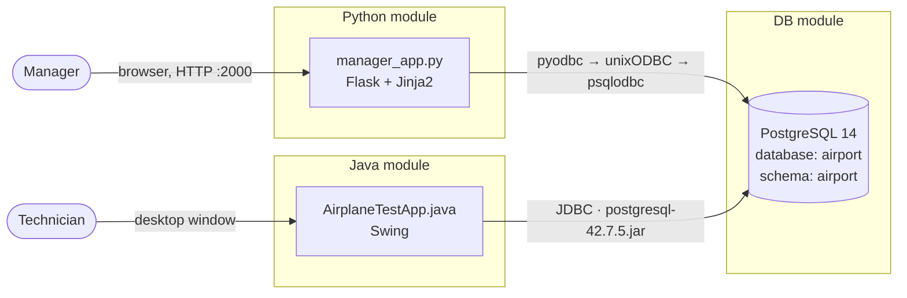
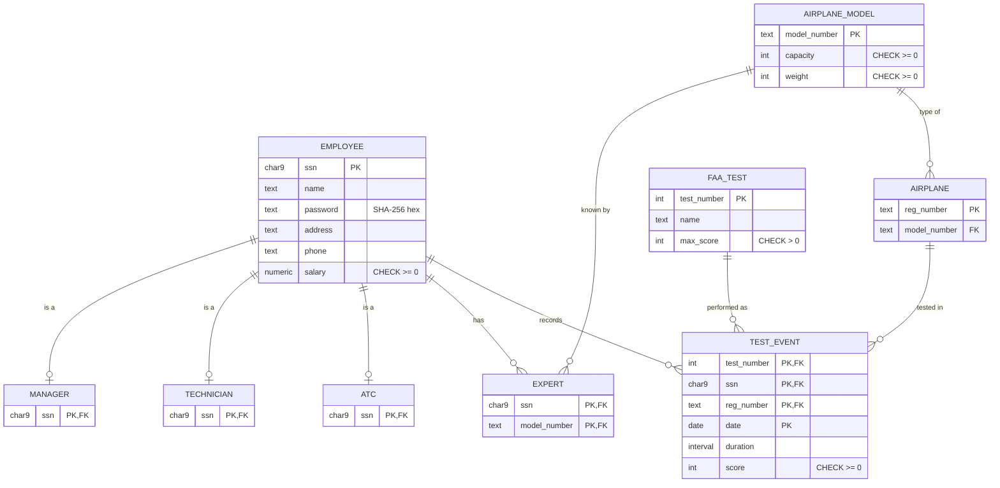

# Architecture

This document describes what the system is made of and how the parts connect. For runtime behaviour, design decisions and limitations, see [SYSTEM_DESIGN.md](SYSTEM_DESIGN.md).

## 1. Overview

The system has three modules. Two independent client applications share one PostgreSQL database. They never talk to each other directly. The database is the only integration point.



| Module | Language / runtime | Entry point | Talks to the DB via |
|---|---|---|---|
| DB | PostgreSQL 14, PL/pgSQL | `create_database.sql` | — |
| Python (manager web app) | Python 3.10, Flask 3 | `manager_app.py` | ODBC (`pyodbc` → unixODBC → `psqlodbcw.so`) |
| Java (technician test app) | Java 11+, Swing | `AirplaneTestApp.java` | JDBC (`org.postgresql` driver 42.7.5) |

## 2. Module trees

### 2.1 DB module: `create_database.sql`

```
create_database.sql
├── Cleanup (makes the script re-runnable)
│   ├── DROP TABLE IF EXISTS … CASCADE
│   └── DROP FUNCTION IF EXISTS raise_salary / add_new_airplane / record_test_event
├── Tables
│   ├── employee            (supertype)
│   │   ├── manager         (subtype, 1:1 on ssn)
│   │   ├── technician      (subtype, 1:1 on ssn)
│   │   └── atc             (subtype, 1:1 on ssn)
│   ├── airplane_model
│   ├── airplane            → airplane_model
│   ├── expert              employee ⟷ airplane_model (M:N)
│   ├── faa_test
│   └── test_event          faa_test × employee × airplane × date
├── Indexes
│   ├── idx_employee_name, idx_employee_salary
│   ├── idx_airplane_model_number
│   └── idx_test_event_score, idx_test_event_date
└── Stored procedures (PL/pgSQL functions)
    ├── raise_salary(p_ssn, p_amount)
    ├── add_new_airplane(p_reg_number, p_model_number)
    └── record_test_event(p_test_number, p_technician_ssn, p_reg_number, p_date, p_duration, p_score)
```

### 2.2 Python module: `manager_app.py` + `templates/`

```
manager_app.py
├── Configuration
│   ├── DSN                         ODBC connection string
│   └── app = Flask(__name__)       SECRET_KEY = os.urandom(24)
├── Helpers
│   ├── login_required              decorator → redirects to /login without a session
│   ├── hash_password / verify_password     SHA-256 hex
│   └── parse_float / parse_int     return None for empty or invalid input
├── Data-access functions (read)
│   ├── get_employees()             employee + derived role (Manager/Technician/ATC)
│   ├── get_airplane_models()
│   ├── get_airplanes()
│   ├── get_faa_tests()
│   └── get_airworthiness_tests()   all rows of test_event
└── Routes (all except /login require a session)
    ├── Auth          /login  /logout                                   → login.html
    ├── Home          /                                                 → index.html
    ├── Employees     /employee/add  /employee/update  /employee/delete → employees.html
    ├── Salaries      /update_salaries                                  → salary.html
    ├── Expertise     /expertise                                        → expertise.html
    ├── Models        /models/add  /models/update  /models/delete       → models.html
    ├── Airplanes     /airplanes/add  /airplanes/update  /airplanes/delete → airplanes.html
    ├── FAA tests     /faa_tests/add  /faa_tests/update  /faa_tests/delete → faa_tests.html
    └── Test results  /tests                                            → tests.html

templates/            Jinja2; each CRUD page takes an `action` (Add/Update/Delete)
password.py           standalone helper: prints SHA-256 of a hard-coded password
```

### 2.3 Java module: `AirplaneTestApp.java`

```
AirplaneTestApp (single class)
├── Configuration
│   └── DB_URL, DB_USER, DB_PASSWORD          static final constants
├── State
│   ├── loginFrame, testEventFrame            JFrame windows
│   ├── input fields                          username, password, hours/min/sec, score
│   ├── airplaneDropdown, testDropdown        JComboBox<String>
│   └── loggedInTechnicianId                  int (SSN of the logged-in technician)
├── Entry
│   └── main() → SwingUtilities.invokeLater(AirplaneTestApp::new) → createLoginFrame()
├── UI helpers
│   └── createLabel / createTextField / createPasswordField / createButton
├── Screens
│   ├── createLoginFrame()                    username + password
│   └── showTestEntryScreen()                 airplane, FAA test, duration, score
└── Database operations (each opens its own connection)
    ├── authenticateTechnician()              SELECT password … JOIN technician
    ├── populateDropdown(dropdown, sql)       SELECT reg_number / test_number
    ├── submitTestRecord()                    INSERT INTO test_event
    └── hashPassword()                        SHA-256 hex (matches Python's hashlib)
```

## 3. Data model



Key points:
- **Specialization.** `manager`, `technician` and `atc` each share the `employee` primary key. The roles are designed as a *disjoint* specialization. The web app enforces disjointness by removing an employee from all three role tables before assigning a new role. The schema itself doesn't prevent one SSN from appearing in two role tables.
- **Referential actions.** Every foreign key is `ON DELETE CASCADE`. Deleting an employee, model, airplane or FAA test removes its dependent rows.
- **Schema placement.** The DDL uses unqualified names. Both apps query `airport.<table>`, so the script must run with `search_path=airport` (see the README quick start).

## 4. Connectivity stack

```
Python                                   Java
──────                                   ────
manager_app.py                           AirplaneTestApp.java
   │  pyodbc.connect(DSN)                   │  DriverManager.getConnection(URL, user, pw)
   ▼                                        ▼
pyodbc (C extension)                     java.sql API
   ▼                                        ▼
unixODBC driver manager                  org.postgresql.Driver
   │  looks up DRIVER= in odbcinst.ini      │  (postgresql-42.7.5.jar on the classpath)
   ▼                                        │
psqlodbcw.so (PostgreSQL Unicode)           │
   └──────────────┬─────────────────────────┘
                  ▼
        PostgreSQL wire protocol, TCP localhost:5432
                  ▼
        PostgreSQL 14 → database "airport" → schema "airport"
```

When the database is on a remote host, an SSH local port-forward maps `localhost:5432` to the remote server, so neither app's code changes.

## 5. Deployment view

| Concern | Current setup |
|---|---|
| Hosting | Everything runs on one developer machine |
| Web server | Flask development server, `127.0.0.1:2000`, `debug=True` |
| Desktop app | Launched straight from source: `java -cp .:postgresql-42.7.5.jar AirplaneTestApp.java` |
| Database | Homebrew `postgresql@14` service on `localhost:5432` |
| Secrets | Connection settings are hard-coded constants in each app |
| Dependencies | Python: `.venv` (git-ignored) with `flask` and `pyodbc`. Java: the vendored JDBC jar. |
