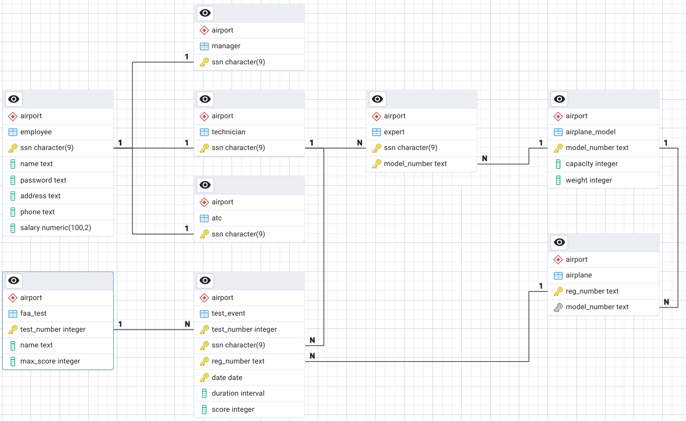

# Project Overview – AirportDB

AirportDB is a personal project for getting hands-on experience with **PostgreSQL**, **ODBC** and **JDBC**. It models a small airport's operations: the airport's employees, its airplanes and airplane models, and the FAA airworthiness tests run on those airplanes.

There are two kinds of users:

- **Managers** use a **web application** to manage employees, airplanes and FAA test definitions, and to view test results.
- **Technicians** use a **standalone desktop application** to record the airworthiness tests they perform.

Managers are a **disjoint specialization** of employees, alongside technicians and air traffic controllers (ATC). Each employee has at most one of these roles.

For setup and run instructions, see the [README](../README.md). For how the pieces fit together, see [ARCHITECTURE.md](ARCHITECTURE.md) and [SYSTEM_DESIGN.md](SYSTEM_DESIGN.md).

---

## Components

| Part | Stack | What it delivers |
|---|---|---|
| 1. Database | PostgreSQL, PL/pgSQL | `create_database.sql`: the schema, constraints and stored procedures |
| 2. Manager web app | Python, Flask, pyodbc (ODBC) | `manager_app.py` + `templates/`: the management UI |
| 3. Airplane test app | Java, Swing, JDBC | `AirplaneTestApp.java`: the technician test-recording UI |

```
AirportDB
├── Part 1  Database           create_database.sql
├── Part 2  Manager web app    manager_app.py ── templates/*.html
└── Part 3  Airplane test app  AirplaneTestApp.java ── postgresql-42.7.5.jar
```

---

## Part 1: Database (PostgreSQL)

The database implements the relational model below.



### Goals

- Create the tables, primary keys and foreign keys from the relational model.
- Enforce data rules with `NOT NULL`, `CHECK`, `UNIQUE` and `FOREIGN KEY` constraints.
- Enforce business rules at the database level with **stored procedures**.
- Keep the script **schema-only**, with no data inserted, so it can rebuild the database from scratch at any time.

### Result

- **9 tables:** `employee`, `manager`, `technician`, `atc`, `airplane_model`, `airplane`, `expert`, `faa_test`, `test_event`.
- **Constraints:** 9 foreign keys, 5 `CHECK` constraints and composite primary keys on `expert` and `test_event`.
- **5 indexes** on commonly searched columns.
- **3 stored procedures:**
  - `raise_salary`: a raise must be positive, and the employee must exist.
  - `add_new_airplane`: the model must exist, and the registration number must be unique.
  - `record_test_event`: only technicians may record tests, and the score must be within the test's maximum.

---

## Part 2: Manager web application (Python + Flask + ODBC)

A Flask web app that managers sign in to and use to run the airport's records.

### Goals

- Connect to PostgreSQL through **ODBC** (`pyodbc` with the PostgreSQL ODBC driver).
- Authenticate managers. Passwords are stored as **SHA-256 hashes**, never in plaintext (see `password.py`).
- Provide the following operations:
  - Add, update and delete employees, and assign their role.
  - Apply a salary raise, and manage which airplane models each technician is an expert in.
  - Manage airplane models and airplanes.
  - Manage FAA test definitions.
  - View the airworthiness tests that technicians have recorded.
- **Partial updates:** an update changes only the fields the user filled in.
- **Dependency-aware deletes:** deleting a record accounts for the rows that depend on it.

### Result

- 14 create, update and delete routes, plus 5 query helpers.
- Every query uses **parameterized SQL**, to guard against SQL injection.
- Login is restricted to employees who are in the `manager` table.

---

## Part 3: Airplane test application (Java + JDBC)

A Swing desktop app for technicians.

### Goals

Technicians can:
- Log in with their credentials.
- Select an airplane and an FAA test.
- Record a test event with its duration and score.

On the database side, the app:
- Connects to PostgreSQL through **JDBC**.
- Authenticates technicians against SHA-256 password hashes.
- Fetches the lists of airplanes and FAA tests for the dropdowns.
- Inserts new test events.

### Result

- Login checks the hash against employees who are in the `technician` table.
- Dropdowns are filled live from the `airplane` and `faa_test` tables.
- Test events are saved with today's date and a duration built with `make_interval`.

---

## Success criteria

- `create_database.sql` runs cleanly on an empty database, and the result matches the relational model.
- At least one stored procedure enforces a business rule.
- Both applications run without errors and read and write the database correctly.
- Neither app needs changes to its UI layer (HTML templates or Swing layout) to work with the database. All integration work happens in the data-access code.

---

## Running it

Both apps run locally against a PostgreSQL server on `localhost:5432`.

| App | Command | Access |
|---|---|---|
| Manager web app | `python manager_app.py` (from the activated virtualenv) | http://127.0.0.1:2000 |
| Airplane test app | `java -cp .:postgresql-42.7.5.jar AirplaneTestApp.java` | desktop window |

If the database runs on a remote host, forward the port over SSH first:

```bash
ssh -N -L 5432:localhost:5432 <user>@<db-host>
```

Both apps then connect as if the database were on `localhost:5432`. The [README](../README.md) has the full setup: the ODBC driver, creating the schema, and seeding the first manager and technician.
