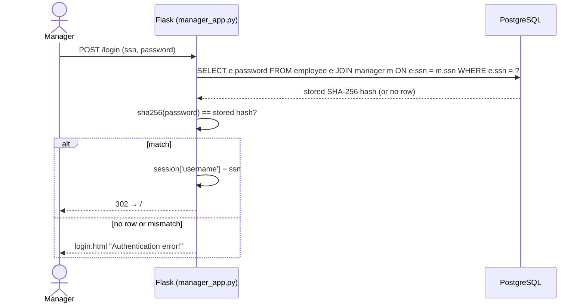
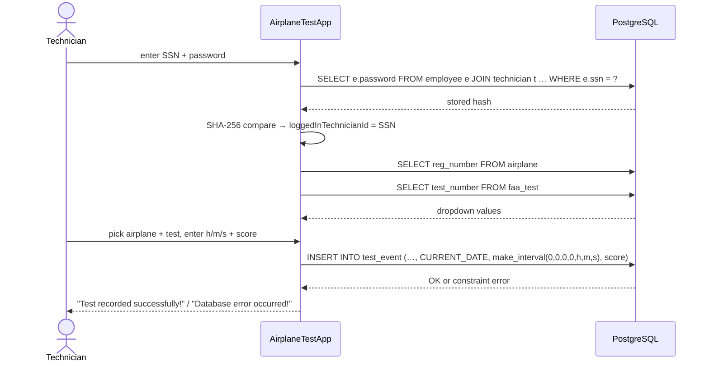

# System Design

This document covers how the system behaves at runtime, why it is built this way, and where it falls short. For the component and data-model reference, see [ARCHITECTURE.md](ARCHITECTURE.md).

## 1. Requirements

### Functional

| # | Requirement | Where it lives |
|---|---|---|
| F1 | Managers log in with SSN + password | `manager_app.py` `/login` |
| F2 | Managers add, update and delete employees and assign a role (Manager, Technician or ATC) | `/employee/*` |
| F3 | Managers apply a percentage raise to all salaries | `/update_salaries` |
| F4 | Managers add and remove technician expertise per airplane model | `/expertise` |
| F5 | Managers manage airplane models, airplanes and FAA tests | `/models/*`, `/airplanes/*`, `/faa_tests/*` |
| F6 | Managers view all recorded airworthiness tests | `/tests` |
| F7 | Technicians log in with SSN + password | `AirplaneTestApp.authenticateTechnician` |
| F8 | Technicians record a test event (airplane, FAA test, duration, score) | `AirplaneTestApp.submitTestRecord` |
| F9 | At least one business rule is enforced in the database by a stored procedure | `create_database.sql` |

### Non-functional / constraints

- **Stored hashes.** Passwords are stored as SHA-256 hex digests, never as plaintext.
- **Partial updates.** An update changes only the fields the user filled in.
- **Safe deletes.** Deleting a row must account for the rows that depend on it.
- **Stable UI contract.** The HTML templates are a fixed interface. Changes are confined to the data layer, so the pages keep working unchanged.
- **Clean schema script.** `create_database.sql` must create everything from scratch and insert no data.

## 2. Key flows

### 2.1 Manager login (web)



Joining on `manager` means only managers can sign in. A technician's correct password still fails here.

### 2.2 Typical CRUD request (web)

Every protected route follows the same pattern:

```
request ─► @login_required ─► parse form (strip, '' → None, parse_int/parse_float)
        ─► pyodbc.connect(DSN) ─► parameterised SQL (?) ─► commit ─► close
        ─► re-query lists via get_*() ─► render_template(page, rows, action)
```

- **Partial update (`/employee/update`).** The `UPDATE` is built only from fields that are non-empty. Each column name comes from code, and every value is bound as a `?` parameter. The role is then reset: the SSN is deleted from all three role tables and re-inserted into the one selected.
- **Salary raise (`/update_salaries`).** A single statement updates every employee: `UPDATE employee SET salary = salary * (1 + CAST(? AS NUMERIC))`. The `CAST` is needed because the ODBC driver sends the value as text. Without it, PostgreSQL infers `integer` and rejects values like `0.1`.

### 2.3 Technician records a test (desktop)



The `make_interval` arguments are positional: years, months, weeks, days, hours, mins, secs. Named arguments (`hour :=`) aren't valid. The parameter names are `hours`, `mins` and `secs`.

## 3. Design decisions

| Decision | Rationale | Trade-off |
|---|---|---|
| **One shared database, two independent clients** | Each user group gets a tool suited to its job (web for back-office work, desktop for floor technicians). The DB is the single source of truth. | No API layer, so validation logic is spread across both apps and the database. |
| **ODBC for Python, JDBC for Java** | Shows both standard database connectivity APIs, one per client | ODBC needs an OS-level driver manager plus driver registration (`odbcinst.ini`). JDBC only needs a jar. |
| **Supertype/subtype tables for roles** | Matches the EER specialization. Role-specific attributes can be added later without touching `employee`. | Disjointness isn't enforced by the schema, only by the web app (see §5). |
| **SSN as the login identifier** | Already the natural key on `employee`, so there's no extra username column | SSNs are sensitive. A real system would use a separate login ID. |
| **SHA-256 hashing done in the apps** | Both languages produce identical hex digests, so either app can verify a password set by the other | No salt and a fast hash (see §5). |
| **Parameterised queries everywhere** | Prevents SQL injection from form input | — |
| **`ON DELETE CASCADE` on all FKs** | Keeps deletes simple. Removing a parent cleans up dependents automatically. | Deleting an airplane model silently deletes its airplanes and their test history. |
| **Business rules in PL/pgSQL** | Rules live next to the data and apply to every client | They only protect data if clients call them (see §5). |
| **Schema-qualified SQL (`airport.table`)** | Keeps the app's tables in a dedicated `airport` schema, separate from `public` | Requires the schema to exist and the DDL to run under `search_path=airport`. |

### Stored procedures

| Function | Business rule |
|---|---|
| `raise_salary(ssn, amount)` | A raise must be positive, and the employee must exist |
| `add_new_airplane(reg, model)` | The model must exist, and the registration number must be unique |
| `record_test_event(test, ssn, reg, date, duration, score)` | Only technicians may record tests. The test and the airplane must exist. The score must be between 0 and the test's `max_score`. |

## 4. Data integrity summary

| Rule | Enforced by |
|---|---|
| Unique SSN / model / registration / test number | Primary keys |
| Airplane must reference a real model; test events must reference real rows | Foreign keys |
| Non-negative salary, capacity, weight and score; positive max score | `CHECK` constraints |
| Required name, password and model fields | `NOT NULL` |
| Only update fields the user filled in | Web app (dynamic `UPDATE`) |
| Employee has at most one role | Web app (reset before assigning) |
| Score ≤ max score; only technicians record tests | `record_test_event` (when called) |

## 5. Known limitations and improvements

| Area | Current behaviour | Suggested improvement |
|---|---|---|
| Stored procedures unused by apps | Both apps write with direct `INSERT`/`UPDATE`, so the PL/pgSQL rules (score ≤ max score, technician-only) are bypassed | Call `record_test_event(...)` from Java and `add_new_airplane(...)` from Flask, or move the rules into triggers |
| Role disjointness | The schema allows one SSN in both `manager` and `technician` | Add a trigger, or a `role` column on `employee` with a `CHECK` |
| `expert` table | Its FK references `employee`, not `technician`, so non-technicians can be given expertise | Reference `technician(ssn)` instead |
| Password hashing | Unsalted SHA-256 | Use bcrypt/argon2 or `pgcrypto` `crypt()` with a salt |
| Connections | A new connection per query or request, with no pooling | Use a connection pool (e.g. psycopg pool / HikariCP), or reuse a per-request connection |
| Error handling | Most routes have no `try`/`except`. Constraint violations surface as a Flask error page. `get_employees` closes `cnxn` in `finally` even when the connect failed. | Wrap DB work, show user-facing messages, and roll back on error |
| Deletes | Rely entirely on `ON DELETE CASCADE`. Users get no warning about the dependent rows that will be removed. | Check dependents first and confirm, or use `RESTRICT` |
| Test date | Always `CURRENT_DATE`. Technicians can't back-date a test. | Add a date field to the form |
| Technician ID | Parsed with `Integer.parseInt`, so SSNs with a leading zero break | Keep the SSN as a string end-to-end |
| Config and secrets | DSN and credentials are hard-coded. `SECRET_KEY` is random per start, so sessions reset on restart. | Read from environment variables or a `.env` file |
| Web server | Flask dev server with `debug=True` | Use gunicorn/waitress behind a reverse proxy, with debug off |
| Tests | None automated | Add pytest with a test database, plus JUnit for the Java DB layer |
